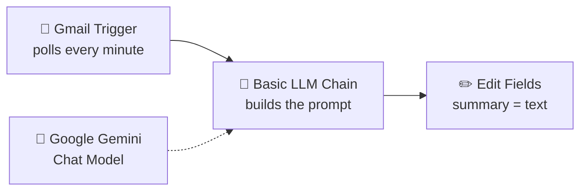

# 📩 AI Email Summarizer with n8n + Google Gemini

An automation that reads every new email in Gmail and turns it into a short, plain-text summary with action items and deadlines, using **n8n** and **Google Gemini**. It runs locally with **Docker**.


---

## ✨ What it does

- Checks your Gmail inbox for new emails **every minute**
- Sends each email's sender, subject and text to **Google Gemini**
- Gemini returns a **2–3 bullet summary** (under 60 words) that highlights action items and deadlines
- n8n outputs a clean `summary` field, ready to send to Telegram, Google Sheets, WhatsApp or any other app

## 🔄 How it works



| Node | Purpose |
|------|---------|
| **Gmail Trigger** | Watches the inbox and fires when a new message arrives |
| **Basic LLM Chain** | Combines the instruction with the email's `From`, `Subject` and `snippet` |
| **Google Gemini Chat Model** | The AI model that writes the summary |
| **Edit Fields** | Saves Gemini's response as a clean `summary` field |

## 🛠️ Tech stack

- [n8n](https://n8n.io) (workflow automation, self-hosted)
- [Docker Desktop](https://www.docker.com/products/docker-desktop/)
- [Gmail API](https://developers.google.com/gmail/api) with OAuth2 (Google Cloud Console)
- [Google Gemini](https://aistudio.google.com) via Google AI Studio (Flash model)

## 📁 Repository structure

```
├── email-summarizer-workflow.json   # n8n workflow (import this)
├── workflow-screenshot.png          # Screenshot of the workflow
└── README.md
```

---

## 🚀 Setup

### Prerequisites

- Docker Desktop installed and running
- A Google account (Gmail)
- A free Google AI Studio API key

### 1. Run n8n with Docker

Open Docker Desktop and wait until it shows **Engine running**, then run:

```bash
docker volume create n8n_data
docker run -d --name n8n --restart unless-stopped -p 5678:5678 -v n8n_data:/home/node/.n8n docker.n8n.io/n8nio/n8n
```

Open **http://localhost:5678** and create your n8n account.

### 2. Set up the Gmail API in Google Cloud

1. Go to [Google Cloud Console](https://console.cloud.google.com/) and create a new project.
2. Go to **APIs & Services → Library**, search for **Gmail API** and click **Enable**.
3. Open **Google Auth Platform → OAuth consent screen**, choose **External**, and fill in the app name and your email.
4. Under **Audience → Test users**, add your own Gmail address.
5. Go to **Clients → Create client**, choose **Web application**, and under **Authorized redirect URIs** add:
   ```
   http://localhost:5678/rest/oauth2-credential/callback
   ```
6. Copy the **Client ID** and **Client Secret**.

### 3. Get a Gemini API key

Go to [Google AI Studio](https://aistudio.google.com), click **Get API key → Create API key**, and copy it.

### 4. Import the workflow

1. In n8n, create a new workflow, click the **⋯** menu and choose **Import from File**.
2. Select `email-summarizer-workflow.json`.
3. Open **Gmail Trigger** → create a new **Gmail OAuth2** credential → paste the Client ID and Secret → **Save** → **Sign in with Google**.
4. Open **Google Gemini Chat Model** → create a new credential → paste your API key → choose a **Flash** model.

### 5. Test and publish

1. Click **Fetch Test Event** on the Gmail Trigger, then **Execute step** on each node.
2. Check the `summary` field in the **Edit Fields** output.
3. Click **Publish** to run it automatically. Results appear in the **Executions** tab.

---

## 💬 The prompt

```
Summarize the email below in 2–3 short bullet points. Use plain text only, no markdown or asterisks. Mention any action items or deadlines. Keep it under 60 words. No preamble.

From: {{ $json.From }}
Subject: {{ $json.Subject }}
Email: {{ $json.snippet }}
```

Change the first line to adjust the style, for example *"Summarize this email in one sentence"* or *"List only action items and deadlines."*

### Example output

```
• A university is offering a certificate program in Agentic AI covering Python, LangGraph and Docker.
• Action item: Review the course details and enrollment information to apply.
```

---

## 🧯 Troubleshooting

| Problem | Cause | Fix |
|---------|-------|-----|
| `failed to connect to the docker API ... dockerDesktopLinuxEngine` | Docker engine not running | Open Docker Desktop and wait for **Engine running** |
| `Invalid Origin: URIs must not contain a path` | Redirect URI added under JavaScript origins | Add it under **Authorized redirect URIs** instead |
| `Error 403: access_denied` / "Access blocked" | Your email is not a test user | Add your Gmail under **Audience → Test users** |
| `redirect_uri_mismatch` | Redirect URI doesn't match n8n's exactly | Copy the URL shown in the n8n credential window |
| `No prompt specified` | Prompt left as `{{ $json.chatInput }}` or placed in a System message | Set **Source for Prompt** to *Define below* and put the prompt in the main field |
| Gmail stops working after a week | OAuth tokens expire every 7 days while the app is in Testing mode | Reconnect the credential, or publish the app in **Audience** |

## ⚠️ Limitations

- Runs only while your PC and Docker are on (use n8n Cloud or a server for 24/7)
- Uses the Gmail **snippet** (~200 characters), not the full email body
- Summarizes all incoming mail, including promotions, unless you add a filter
- Subject to Gemini free-tier rate limits

## 🗺️ Next steps

- [ ] Send summaries to Telegram
- [ ] Log summaries in Google Sheets
- [ ] Filter out promotional emails
- [ ] Summarize the full email body instead of the snippet

## 🙏 Credits

Built by following **Hansuja**'s n8n email summarizer tutorial (Episode 1).

## 🔒 Security note

No API keys or secrets are stored in this repository. The workflow file only contains credential *names*; you connect your own Gmail and Gemini accounts after importing it.
